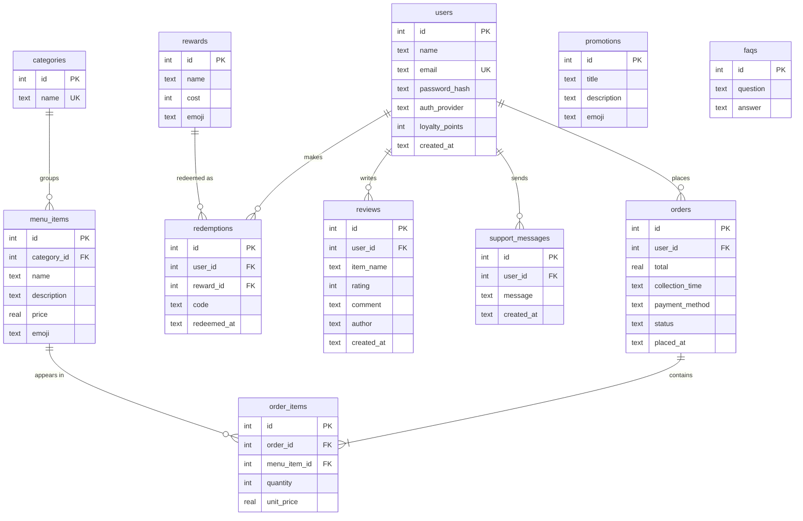

# Database

The app stores its data in an on-device **SQLite** database (`monate.db`). It is created and filled
with starting data the first time the app runs (`MonateDbHelper`, `SeedData`). Foreign keys are switched on,
so SQLite rejects rows that point at something that does not exist.

**Passwords are not kept here.** Login accounts and passwords live online in Firebase Authentication
(see [SSO_SETUP.md](SSO_SETUP.md)). The `users` table is the customer's profile in the app (name, email, points) and is
matched to the Firebase login by email. `password_hash` is empty for customers who registered through Firebase, and for
Google customers.

## Tables and relationships

## Starting records (requirement: 10+ per table)

| Table | Records | Used for |
|---|---:|---|
| users | 10 | customer profiles (the 10 samples carry a local password hash that only the unit tests use; customers who register through Firebase or Google have none) |
| categories | 10 | menu filter chips |
| menu_items | 25 | menu and item details |
| orders | 12 | order history and tracking (some still in progress for demos) |
| order_items | 26 | the lines of each order |
| reviews | 12 | reviews and ratings |
| rewards | 10 | loyalty rewards |
| redemptions | 10 | reward codes already issued |
| promotions | 10 | "Specials & offers" on Home |
| faqs | 10 | Help & Support |
| support_messages | 10 | messages sent from Help & Support |

The unit test `SeedDataTest` checks these counts (and that all references between tables are valid) on every push,
and the on-device test `DatabaseTest` checks the real database.

The sample customers are local records. To log in as one in the app, add the same email in the Firebase console
(**Authentication > Users > Add user**) with a password of your choice, for example `demo@monate.co.za`. The app matches
by email, so that login shows the sample customer's orders, points and reviews.
The promotions are sample content built from the real menu prices; edit them in `SeedData.kt`.

## Rules worth knowing

- Deleting a user also deletes their orders, order lines and redemptions. Their reviews and support messages stay, with the user link cleared.
- `order_items.unit_price` keeps the price paid at the time, so history is correct even if menu prices change later.
- Order totals = item lines + R25 delivery fee (same rule as the cart).
- Changing the schema: raise `DB_VERSION` in `MonateDbHelper`. At the moment an upgrade rebuilds the database; add real migrations before a public release.
